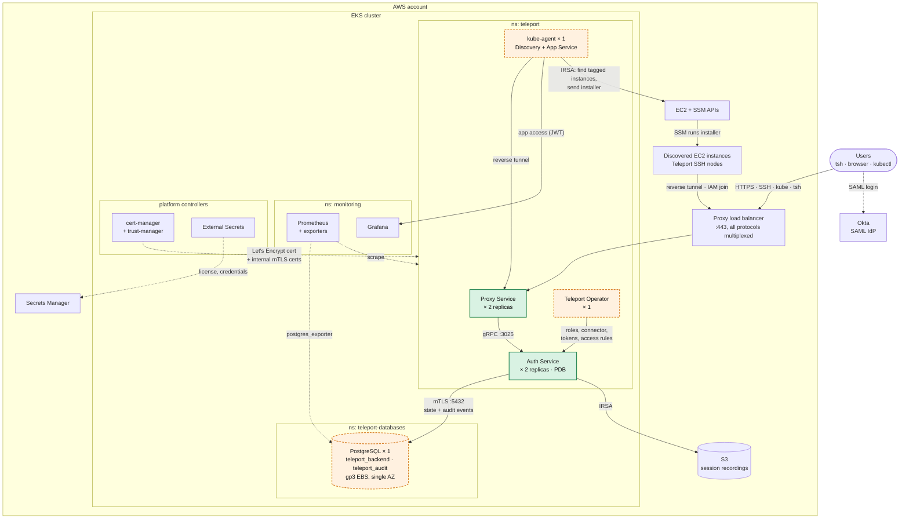
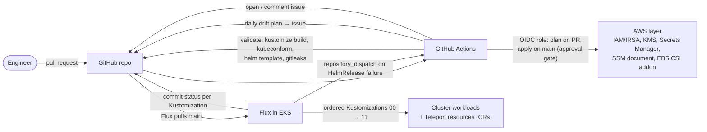

# Teleport on EKS — GitOps demo

A demo **Teleport Enterprise** cluster running on **Amazon EKS**, deployed and managed with **Flux** (cluster state), **Terraform** (AWS IAM/secrets layer), and **GitHub Actions** (validation, plan/apply, drift and failure reporting).

It is set up to demonstrate:

- **SSO + RBAC** — Okta SAML groups map to Teleport roles (`teleport-resources/connectors/okta.yaml`).
- **Just-in-time access requests** — users get a minimal base role and request elevated access (SSH, root SSH, Kubernetes) with a required justification. Plain SSH access is **auto-approved** by an access monitoring rule; root and Kubernetes access need a human approver.
- **Kubernetes access** scoped to a namespace taken from an Okta user attribute, backed by native Kubernetes RBAC (`k8s-rbac/`).
- **Application access** — Grafana published through Teleport with JWT auth.
- **EC2 auto-discovery** — the Discovery Service finds tagged EC2 instances and installs/joins Teleport over SSM using an IAM join token (no static secrets).
- **Host user creation** — Teleport creates per-user Linux accounts (stable UIDs) on login.
- **Observability** — Prometheus/Grafana with Teleport, Postgres, Flux, cert-manager, and external availability metrics.

## Architecture

### Runtime



**Legend:** green = horizontally scaled for HA · orange dashed = single instance · solid arrows = request/data path · dotted arrows = supporting/control path.

Notes on HA:

- **Proxy** and **Auth** each run 2 replicas (`highAvailability.replicaCount: 2`) with a PodDisruptionBudget. Auth is stateless in-cluster: all state lives in Postgres and S3, so either replica can serve.
- **PostgreSQL** is a single-replica StatefulSet pinned to one AZ (its EBS volume is zonal). It is the main single point of failure in this demo; a production build would use RDS/Aurora Multi-AZ.
- The **kube-agent** (Discovery + App Service) and **Operator** are single replicas. Losing them pauses discovery, Grafana access, and CR reconciliation, but not logins or existing SSH access.

### Delivery



## Repository layout

| Path | What it holds |
| --- | --- |
| `terraform/` | AWS resources Flux depends on: IRSA roles, KMS key, Secrets Manager secrets (placeholders), SSM installer document, EC2 node instance profile, GitHub OIDC CI role, EBS CSI addon. Assumes the EKS cluster, S3 buckets, and Route53 zone already exist. |
| `clusters/<cluster>/` | Flux entrypoint. Numbered Kustomizations define apply order via `dependsOn`. |
| `infrastructure/` | Namespaces, Helm repos, `cluster-vars` (shared substitution values), cert-manager, trust-manager, External Secrets, Reloader, internal PKI, Postgres, monitoring, Flux notifications. |
| `apps/teleport-cluster/` | `teleport-cluster` Helm release (Auth, Proxy, Operator). |
| `apps/teleport-agents/` | `teleport-kube-agent` Helm release (Discovery + App Service). |
| `teleport-resources/` | Teleport config as Kubernetes CRs: IAM join token, Okta SAML connector, access monitoring rule, roles. |
| `k8s-rbac/` | Kubernetes RBAC for the groups the `okta-kube-access` role impersonates. |
| `.github/workflows/` | `validate`, `terraform`, `drift`, `flux-helmrelease-failure`. |

Flux apply order: `infra-base → infra-controllers → infra-pki → postgres / infra-config → monitoring → monitoring-exporters / teleport-cluster → teleport-resources (tokens → connectors → access rules → roles) → teleport-agents`. `k8s-rbac` and `notifications` reconcile alongside.

## Roles at a glance

| Okta group | Teleport roles | Can do |
| --- | --- | --- |
| `teleport-users` | `okta-base-requester` | Request `okta-ssh-access` (auto-approved), `okta-ssh-root`, or `okta-kube-access` with a justification; max 8h. |
| `teleport-admins` | `editor`, `access`, `okta-approver` | Administer the cluster; approve root SSH, Kubernetes, and prod SSH requests. |
| `teleport-servicenow-users` | `okta-prod-ssh-requester` | Search-based requests for `aws/env=prod` hosts (ServiceNow plugin demo). |
| `teleport-monitoring` | `okta-grafana-access` | Open Grafana through Teleport app access. |

## Setup

### Prerequisites

**Tools:** `aws`, `terraform` ≥ 1.16, `kubectl`, `flux`, `tsh`/`tctl`.

**Already existing in AWS** (not created by this repo):

- An EKS cluster with an IAM OIDC provider, plus a node group labeled `workload=postgres` and tainted `dedicated=postgres:NoSchedule` (single AZ) for the database.
- A public Route53 hosted zone for your Teleport domain.
- An S3 bucket for session recordings and an S3 bucket for Terraform state.
- An ECR image of PostgreSQL with the `wal2json` extension (required by Teleport's Postgres backend).

**Elsewhere:**

- A Teleport Enterprise license (`license.pem`).
- An Okta SAML app sending a `groups` attribute (groups listed above) and a `team` attribute (used to scope Kubernetes namespace access).
- Two GitHub Apps installed on the repo: one with **Commit statuses: read/write** (Flux commit statuses) and one with **Contents: read/write** (`repository_dispatch`).

### 1. Replace environment-specific values

The repo is currently wired to one environment. Find the values to change with:

```bash
grep -rnE 'daniel|dbteleport|278576220453|us-west-1|okta\.com' \
  --exclude-dir=.git --exclude-dir=.terraform --exclude=gotk-components.yaml .
```

The main files are `infrastructure/base/cluster-vars.yaml`, `apps/teleport-cluster/values.yaml`, `apps/teleport-agents/values.yaml`, `teleport-resources/connectors/okta.yaml`, `teleport-resources/tokens/aws-discovery-iam-token.yaml`, `infrastructure/postgres/statefulset.yaml` (image), and `terraform/versions.tf` (state backend). Rename `clusters/daniel-eks-cluster/` to your cluster name.

### 2. Apply Terraform locally (first run)

The first apply has to run from your machine because it creates the role CI uses.

```bash
cd terraform
cp terraform.tfvars.example terraform.tfvars   # fill in; set create_github_oidc_provider = true if the account doesn't have one
terraform init
terraform apply
terraform output                                # keep these handy
```

Check that the role ARNs in `infrastructure/base/cluster-vars.yaml` match the outputs.

### 3. Fill in the secrets

Terraform creates the secrets with `REPLACE_ME` placeholders and ignores later changes, so set real values out of band (`<prefix>` is your `name_prefix`):

```bash
aws secretsmanager put-secret-value --secret-id <prefix>/enterprise-license \
  --secret-string "$(jq -n --rawfile l license.pem '{"license.pem":$l}')"

aws secretsmanager put-secret-value --secret-id <prefix>/grafana-admin \
  --secret-string '{"admin-user":"admin","admin-password":"<strong password>"}'

# repeat for <prefix>/flux-github-dispatch-app with the second app's values
aws secretsmanager put-secret-value --secret-id <prefix>/flux-github-app \
  --secret-string "$(jq -n --arg id <app-id> --arg inst <installation-id> --rawfile key app.pem \
    '{githubAppID:$id, githubAppInstallationID:$inst, githubAppPrivateKey:$key}')"
```

### 4. Configure GitHub Actions

In the repo settings:

- **Variables:** `AWS_ROLE_ARN` (from `terraform output ci_role_arn`), plus `AWS_REGION`, `NAME_PREFIX`, `EKS_CLUSTER_NAME`, `TELEPORT_NAMESPACE`, `TELEPORT_CLUSTER_NAME`, `SESSION_RECORDING_BUCKET`, `SSM_DOCUMENT_NAME`, `DISCOVERABLE_TAG`, `DNS_ZONE_NAME`, `TF_VAR_GITHUB_REPO`, `TAGS` — the same values as your `terraform.tfvars` (objects/maps as HCL literals).
- **Environment:** create `dev-aws` with required reviewers; Terraform apply waits on it.

### 5. Bootstrap Flux

```bash
aws eks update-kubeconfig --name <cluster> --region <region>
flux bootstrap github \
  --owner=<github-owner> --repository=<repo> --branch=main \
  --path=clusters/<cluster> \
  --components-extra=image-reflector-controller,image-automation-controller
flux get kustomizations --watch
```

### 6. Initialize the database

Once the `postgres` Kustomization is ready, create the roles and databases (auth pods will crash-loop until this is done):

```bash
kubectl -n teleport-databases exec teleport-postgres-0 -- psql -U postgres \
  -c "CREATE ROLE teleport WITH LOGIN REPLICATION" \
  -c "CREATE DATABASE teleport_backend OWNER teleport" \
  -c "CREATE DATABASE teleport_audit OWNER teleport" \
  -c "CREATE ROLE postgres_exporter WITH LOGIN" \
  -c "GRANT pg_monitor TO postgres_exporter"
```

### 7. Point DNS at the proxy

Create Route53 records for `<cluster-name>` and `*.<cluster-name>` (the wildcard is used for app access, e.g. Grafana) pointing at the proxy load balancer:

```bash
kubectl -n teleport get svc teleport -o jsonpath='{.status.loadBalancer.ingress[0].hostname}'
```

### 8. Log in and verify

```bash
flux get kustomizations                 # all Ready
tsh login --proxy=<cluster-name>:443 --auth=okta
tsh request create --roles=okta-ssh-access --reason="demo"   # should auto-approve
```

For break-glass access without Okta:

```bash
kubectl -n teleport exec deploy/teleport-auth -- tctl users add admin --roles=editor,access
```

### 9. Enroll an EC2 instance

Launch an instance in the discovery region with the SSM agent, the instance profile from `terraform output ec2_node_instance_profile`, and the tags `<discoverable-tag-key>=<value>` and `env=dev` (shows up in Teleport as `aws/env=dev`, which the SSH roles match). It should appear in `tsh ls` within a few minutes.

## Day-to-day changes

All changes go through pull requests. `validate` renders and schema-checks every Kustomize path and Helm chart and scans for secrets; Terraform PRs get the plan posted as a comment, and merges to `main` apply after approval. Flux picks up merged manifests within a minute, reports per-Kustomization commit statuses back to GitHub, and failed HelmReleases open (or comment on) a `flux-failure` issue. A daily Terraform plan opens a `drift` issue if AWS was changed outside Git.
